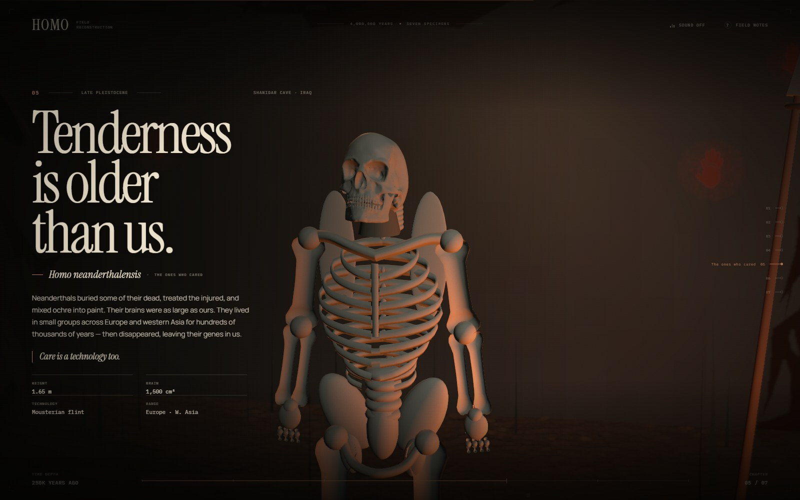
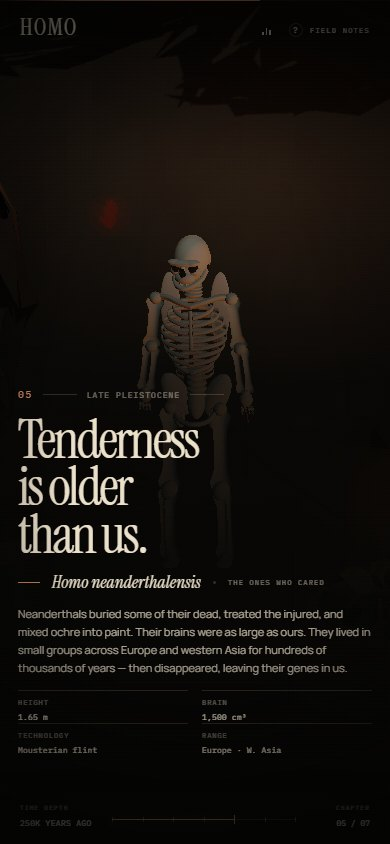

# HOMO

### Four million years, seven chapters, one skeletal reconstruction.

An interactive, scroll-driven journey through the human family — from the Laetoli footprints to the person reading this sentence. Built with Three.js, hand-written shaders, procedural anatomy and a generative soundscape.

**[Live demo → megabomb420.github.io/homo](https://megabomb420.github.io/homo/)**





## The idea

Most evolution timelines are straight lines. Ours is not. **HOMO** treats the fossil record as a braided river: seven species, each one a full-bodied presence rather than a diagram. The central figure is a single skeletal reconstruction, re-proportioned continuously as you scroll. Limbs lengthen, the ribcage changes volume, the skull remodels, the posture lifts upright.

The landscape changes with it: a Pliocene dusk, a Pleistocene campfire, an ice-age whiteout, a painted cave, a dawn with the ancestors still standing in the fog.

## Chapters

| # | Species | Deep time | Place |
|---|---------|-----------|-------|
| 01 | *Australopithecus afarensis* | 3.6 million years ago | Laetoli, Tanzania |
| 02 | *Homo habilis* | 2.1 million years ago | Olduvai Gorge, Tanzania |
| 03 | *Homo erectus* | 1.6 million years ago | Koobi Fora, Kenya |
| 04 | *Homo heidelbergensis* | 600,000 years ago | Schöningen, Germany |
| 05 | *Homo neanderthalensis* | 250,000 years ago | Shanidar Cave, Iraq |
| 06 | *Homo sapiens* | 70,000 years ago | Sulawesi, Indonesia |
| 07 | *Homo sapiens* | now | everywhere |

## Controls

- **Scroll** to travel through deep time.
- **Move the pointer** to shift the air and parallax.
- Use the **chapter rail** on the right, or the **bottom time bar**.
- **Sound** is off by default. The toggle starts a generated wind / drone / fire soundscape.
- **Field notes** explains the project, the science and the craft.
- On the last chapter, **return to the first step**.

## Craft notes

- Procedural skeleton: cranium, jaw, teeth, orbits, vertebrae, ribs, clavicles, pelvis, long bones, hands and feet — all generated from primitives, no model files.
- One continuous scroll timeline drives camera, species proportions, posture, palette, fog, lighting, fire, snow, stars and four million years of geology.
- Custom GLSL for the sky, dust, snow, stars and flame.
- GPU-instanced grass with wind, instanced stones, billboard smoke, a flickering fire light and bloom.
- Canvas-generated textures for bone pores, footprints and negative/positive cave handprints.
- A small synthesised soundscape using Web Audio; no audio files.
- `prefers-reduced-motion` and touch/small-screen layouts are supported.

## Run it

```bash
npm install
npm run dev
```

Then open the local URL printed by Vite.

### Build a single file

```bash
npm run build
```

The result is a self-contained `dist/index.html` — fonts, styles and JavaScript inlined. It can be opened directly from disk or dropped on any static host.

## Science note

This is a poetic reconstruction, not a peer-reviewed diagram. Dates and cranial capacities are rounded and debated. “Earliest known” is doing a lot of work in the copy. The skeleton is deliberately stylised: it is an image of a hypothesis, not a forensic portrait.

## Stack

Three.js · Vite · Lenis · Web Audio · hand-written GLSL · Canvas 2D

## License

MIT. See [LICENSE](LICENSE).
